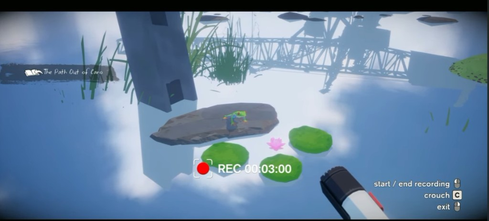

# 待办

完整设计在 [gdd.md](gdd.md)。这一轮只做唱片店里的录音。日夜循环、肉鸽、多人先不动。

现在工程里已经有三条重建好的街、胡同里三种声音的小游戏、Livehouse 里的吉他贝斯鼓，以及单独放着的高斯扫描。终章播的是一条固定曲目。店里还没有人影，也还没有一台拿在手里的录音机。

## 现在做：唱片店

人少。店里只放几个顾客和老板。他们是人影：站着或坐着，不巡逻，不铺成人群。

玩家拿录音笔或录音机，两种都可以。第一段要录的声音是喝酒。酒已经在柜台上，录的是这一口。

参考的是手里的设备和画面上的 REC，不是这张图里的水面。左下角是录音机，中间是准心、红点和已经录了多久。按一下开始，再按一下结束。

- [ ] 唱片店里放老板，再放几个顾客。只保留这几个人影。
- [ ] 手上有录音笔或录音机。开始和结束都由玩家按键控制。画面上有准心、红点和 REC 计时。
- [ ] 第一个声源是喝酒。靠近柜台的酒，对准再录。录清楚的这一段留下来。
- [ ] 离得太远，或没对准，这段就不算数。

## 之后

幻影模式和演奏仍按 GDD 做，排在这一段录音之后。

- [ ] 幻影模式：同一条路的两层。扫描是空的记忆，模型是声音补回来的部分。先从已经能录的房间做起。
- [ ] 声学幽灵：靠近旧物时听见过去的人声。场景里不增加活人。
- [ ] 演奏：Livehouse 演的是这一局里录到的声音。喝酒是第一条音轨。情绪先只改混音。
- [ ] 曲子响的时候，Livehouse 的点云跟着低频鼓起、裂开、收回。

## 先不做

- 日夜、天气，以及用一段声音打开另一间房
- 单局时限、永久留下三个声音、设备升级
- 双人合奏、共享声音库、对讲机
